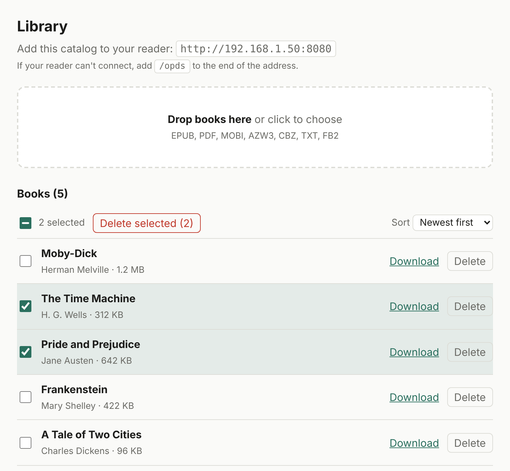

# simpleOPDS



A tiny, dependency-free [OPDS](https://opds.io) ebook server with a drag-and-drop
upload page. Drop EPUBs onto a web page, then browse and download them from any
OPDS-capable e-reader (built with the XTEink in mind, but it's standard OPDS 1.2).

- **One address for both:** open `http://<server-ip>:8080` in a browser for the upload
  page; e-readers that connect to the same address get the OPDS catalog (all books
  A-Z, recently added, search). The catalog is also always available at `/opds`
- Reads title and author from EPUB metadata (falls back to the filename)
- Sort the book list by title, author, date added or size (your choice is remembered)
- Select several books (shift-click for a range, or select all) and delete them in one go
- Supports EPUB, PDF, MOBI, AZW3, CBZ, TXT and FB2
- Python standard library only; small multi-arch image (amd64 and arm64)
- Optional basic auth; runs as a non-root user

## Quick start

```yaml
services:
  opds:
    image: ghcr.io/hkrlogic/simpleopds:latest
    container_name: opds
    restart: unless-stopped
    ports:
      - "8080:8080"
    volumes:
      - opds-books:/books
    read_only: true
    cap_drop:
      - ALL
    security_opt:
      - no-new-privileges:true
    #environment:
    #  OPDS_USER: reader
    #  OPDS_PASS: change-me
    #  MAX_UPLOAD_MB: 500

volumes:
  opds-books:
```

```
docker compose up -d
```

In **Portainer**: Stacks → Add stack → Web editor → paste the above → Deploy.

**To add a password** (recommended if anyone else can reach the port): delete just
the `#` character at the start of the four `environment` lines, leave the spaces
alone, and change `change-me` to your own password. The lines are laid out so
this always gives valid YAML.

Then:

1. Open `http://<server-ip>:8080/` and drag your books onto the page.
2. On your e-reader, add a catalog: `http://<server-ip>:8080` (if it can't
   connect, try `http://<server-ip>:8080/opds`). If you set a username and
   password, enter them in the reader too.

## Configuration

| Variable        | Default | Description                                             |
|-----------------|---------|---------------------------------------------------------|
| `OPDS_USER`     | unset   | Enables HTTP basic auth (with `OPDS_PASS`) everywhere   |
| `OPDS_PASS`     | unset   | Password for basic auth                                 |
| `MAX_UPLOAD_MB` | `500`   | Largest allowed upload                                  |

Books live in `/books` inside the container. The container always runs as an
unprivileged user (UID 1000) and never as root, so the folder you mount has to
be writable by that user:

- **New named volume (as above):** works automatically.
- **Existing volume or bind mount** (e.g. `/srv/books:/books`): make it writable
  once with `sudo chown -R 1000:1000 /srv/books`. For an existing named volume
  in Portainer, open the container's Console as `root` and run
  `chown -R 1000:1000 /books`, or delete the empty volume and redeploy.
- **Not sure?** The container logs a warning at startup if the folder isn't
  writable, and the upload page shows the exact command to run.
- **Need a different UID?** Set `user: "<uid>:<gid>"` in your compose file.

## Security

Without `OPDS_USER`/`OPDS_PASS`, **anyone who can reach the port can upload and
delete books**. That's fine on a trusted home LAN, but set a password before
exposing it any further. The server speaks plain HTTP: if you put it on the
internet, run it behind a reverse proxy that terminates TLS (it honors
`X-Forwarded-Proto` and `X-Forwarded-Host` so catalog links use `https://`).
Basic auth over plain HTTP sends the password unencrypted.

Only the listed ebook extensions can be uploaded, filenames are sanitized,
downloads can't escape the books folder, and state-changing requests require a
custom header so other websites can't trigger them from your browser.

The container never runs as root, and the example compose file drops every
Linux capability, blocks privilege escalation (`no-new-privileges`) and mounts
the root filesystem read-only. The app needs none of those privileges, so a bug
in it has very little to work with. If your Docker host doesn't support one of
these options, remove that line; the app doesn't depend on them.

## Run without Docker

```
python3 server.py --books ./books --port 8080
```

Requires Python 3.8 or newer.

## Build locally

```
git clone https://github.com/hkrlogic/simpleOPDS
cd simpleOPDS
docker build -t simpleopds .
```

## License

[MIT](LICENSE)
